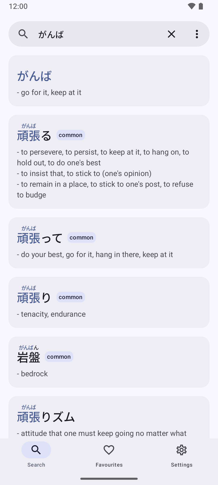
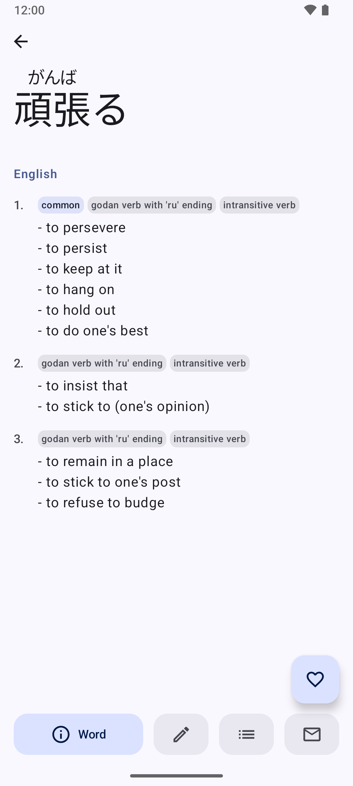
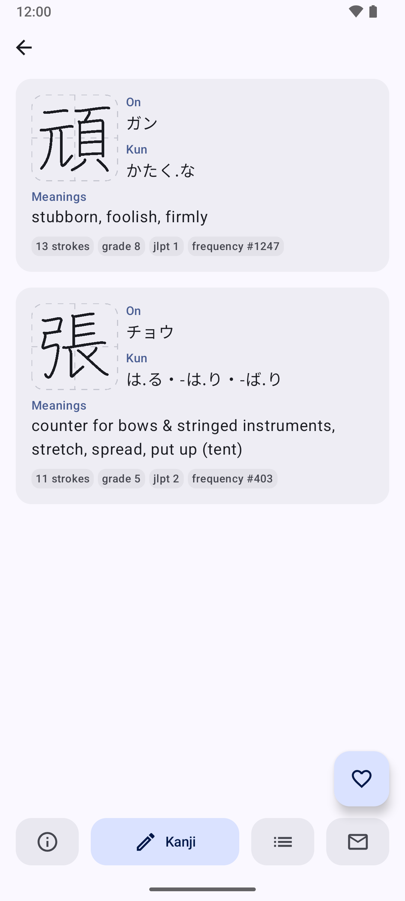
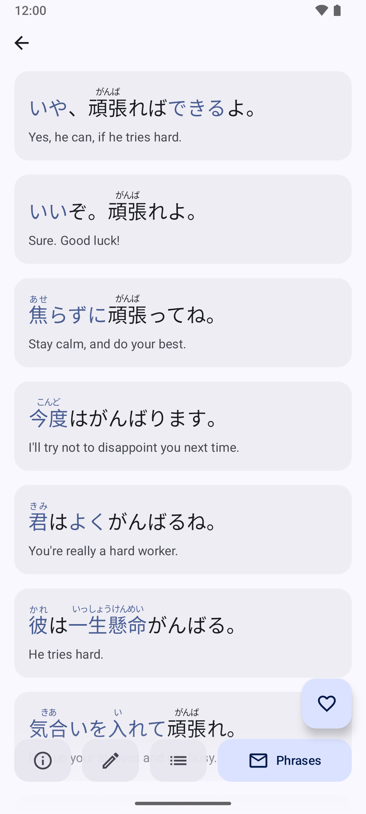
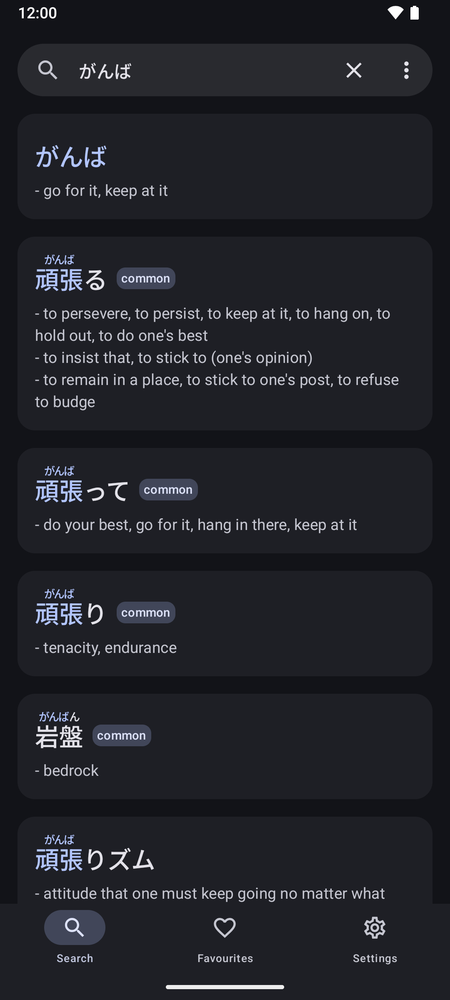
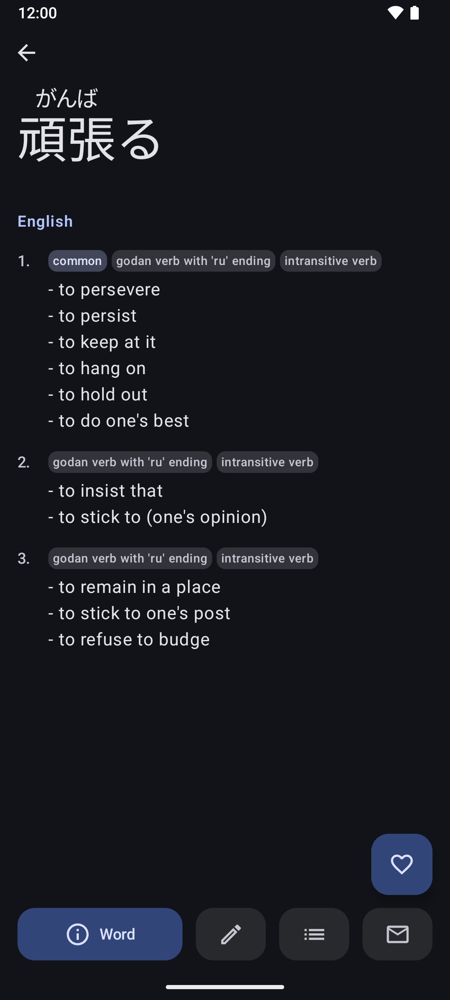
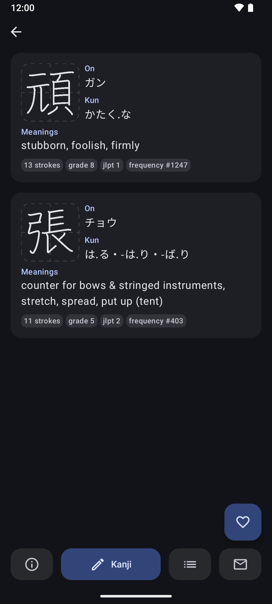
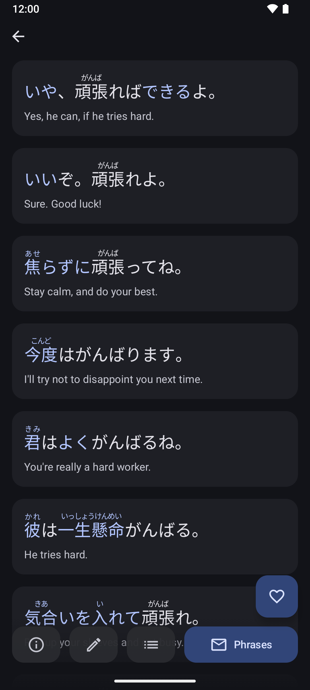

  <h1>Okonomi</h1>
  

  

  Modern Japanese/English dictionary mobile app for language learners. It is built with Kotlin Multiplatform targeting Android and iOS.
  

  

## Screenshots

|                | Search | Word | Kanji | Phrases |
|----------------|--------|------|-------|---------|
| **Light** |  |  |  |  |
| **Dark** |  |  |  |  |

## Features
- **Search** the dictionary for words in English or Japanese using Kanji or Hiragana.
- Learning **English** instead? Flip the dictionary to English to invert the search.
- **Filter** what you are searching for to find words that are most relevant to you.
- Look up **Kanji** with readings, **Radicals** composition and **Stroke Order** animation.
- See example **Phrases** right from the search results, tap words in a sentence to search them.
- Keep a list of your **Favourite** words, export and import them in JSON format.
- Send you favourites straight to an **Anki** deck and keep in sync for further memorization.
- Remember you search **History**, swipe a word to remove it from the list.
- Open straight from your **Selected Text** via the context menu to avoid copy pasting.
- Switch the app **Language** between English and Japanese as you please.
- Requires **No Internet** connection, everything is in **Local** storage on your device.

> [!NOTE]
> This is not a all-in-one study app. It does one thing and aims to do it well - to be a solid dictionary.

## Building

Dependencies, building from source and testing specific instructions live in [BUILDING.md](BUILDING.md).

## AI Use

> | How | Why |
> | :--- | :--- |
> |  | [AI:X](http://0rwx.com) **Most of the project is written with LLM assistance using the [BMAD Method](https://github.com/bmad-code-org/BMAD-METHOD). Documentation is written by me. I simply wanted an open source dictionary, with no sign ups or ads. I couldn't find one so I built my own.** |

## Licenses
- The EDRDG files are used under the [EDRDG licence](https://www.edrdg.org/edrdg/licence.html).
- Tatoeba files under Tatoeba's [terms of use](https://tatoeba.org/en/terms_of_use)
- [KanjiVG](https://kanjivg.tagaini.net/) files are under [CC BY-SA 3.0](https://creativecommons.org/licenses/by-sa/3.0/).

## Mirrors
This repository is hosted on [Forgejo](https://code.hosaka.cc/hosaka/okonomi) which mirrors to the following git forges:
-  - https://codeberg.org/hosaka/okonomi
-  - https://github.com/hosaka/okonomi
